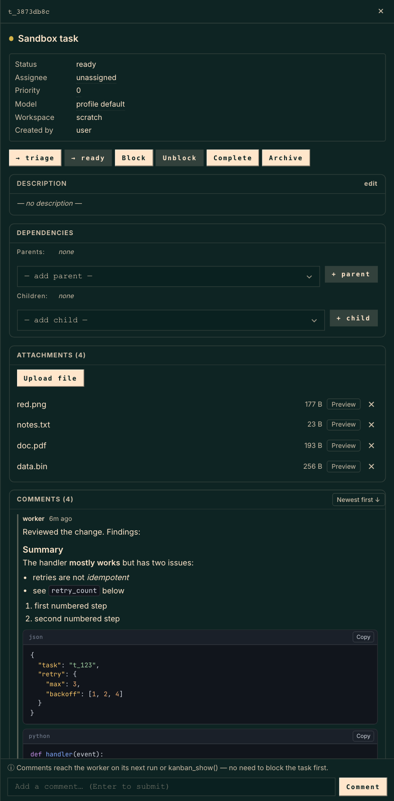

# hermes-kanban-markdown

[](LICENSE)

Full markdown rendering and clearer sections for the [Hermes Agent](https://github.com/NousResearch/hermes-agent) kanban task drawer.

The built-in drawer renders markdown with a small regex renderer: no numbered lists, tables or blockquotes, the language tag of a fenced block shows up as code, and there is no highlighting or copy button. Every section also runs into the next one. This plugin fixes both.



## Features

- Full GFM: headings, nested and numbered lists, task lists, blockquotes, tables, horizontal rules, strikethrough, links.
- Code blocks with a language label, syntax highlighting (bash, css, diff, go, ini/toml, java, js/ts, json, markdown, php, python, ruby, rust, sql, xml/html, yaml), preserved indentation, horizontal scroll, and a **Copy** button.
- Code uses an embedded JetBrains Mono; prose keeps your dashboard font. No external requests.
- Palette follows the active dashboard theme (dark or light is detected from the real background).
- Each drawer section (Description, Dependencies, Attachments, Result, Comments, ...) is a bordered card with its own header band, and comments are divided from each other.
- Safe by construction: raw HTML in task text is shown as literal text, only http, https and mailto links are active, and images are shown as links (never fetched automatically).
- If the markdown source can't be read, the built-in rendering is left untouched.

## Install

User dashboard plugins must be in `~/.hermes/plugins/` **and** listed in `plugins.enabled` of the active profile.

```bash
git clone <this repo> ~/.hermes/plugins/kanban-markdown
hermes plugins enable kanban-markdown
# then restart `hermes dashboard` (plugin discovery is cached per process) and hard-refresh
```

`dashboard/dist/` is committed, so no build step is needed to use it. Uninstall with `hermes plugins disable kanban-markdown` and delete the directory.

## How it works

The drawer has no plugin slots. A `MutationObserver` finds each `.hermes-kanban-md` block, reads the markdown source from the React props of the component that rendered it, and replaces the block with the full render. When the dashboard re-renders a block, the plugin upgrades it again. Section separation is CSS only.

This reads React internals (`__reactFiber$` keys), so a future dashboard refactor could stop the markdown upgrade from applying. In that case the drawer simply falls back to the built-in rendering.

## Development

```bash
npm install
npm run build   # src/ -> dashboard/dist/ (esbuild)
npm test        # node:test unit tests, including XSS payloads
npm run e2e     # Playwright; needs a dashboard with the plugin enabled
```

E2E env: `HERMES_URL` (default `http://127.0.0.1:9229`), `HERMES_TASK` (a task whose comments contain a fenced `json` block, a numbered list, a blockquote and a table), `CHROMIUM_PATH` (optional). Use a throwaway `HERMES_HOME`, not your real one.

## License

MIT. Bundled third-party components are listed in [THIRD_PARTY.md](THIRD_PARTY.md).
